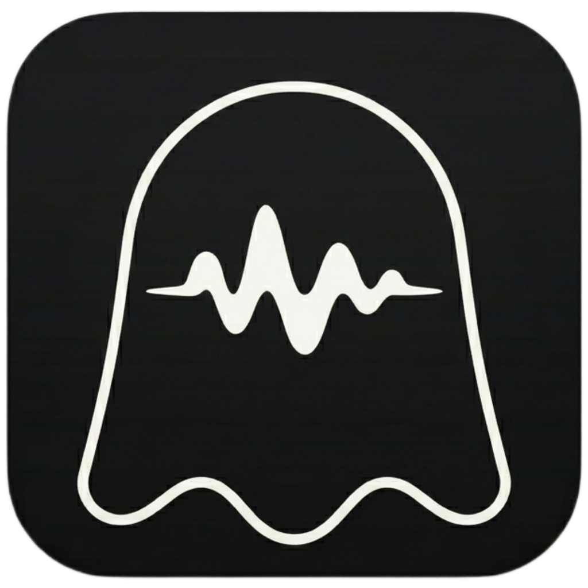

# Ferephono

A little ghost that turns your voice into developer prompts.

Inspired by my macOS-only app, Whisprer, this transcription app runs on Rust and was created for developers who want to dictate prompts to CLI tools, whether or not those tools have their own voice mode.
The features that make it what it is:

- Uses OpenAI's base Whisper model under the hood, fully offline. Nothing that you say leaves your machine.
- Uses post-processing to join the words of a spoken file name, apply the casing and extension for its file type, and add an `@` prefix. For example: “Open the transcript processor dot rust” → “Open the `@transcript_processor.rs`”.
- Optionally matches dictated file references against your repo’s actual filenames using fuzzy matching. For example: “Open the `@transcript_professor.rs`” → “Open the `@transcript_processor.rs`”, if that is a sufficiently close, unambiguous match in your repo.
- A floating ghost that appears every time you prompt, because why not. Its name is Ferephono.

Hold **Right Option**, speak, and release to insert your words into any app.

Currently built for **Apple Silicon Macs and English dictation only**. Other OSs will follow.

## Run it

Requires Rust 1.88+, Node.js/npm, Xcode Command Line Tools, CMake and ripgrep (`rg`).

```sh
npm ci
npm run prepare:runtime
npm run tauri -- dev
```

Runtime preparation downloads and builds whisper.cpp and downloads the English model. Run it once on a fresh checkout.

To build and install in `~/Applications`, quit any running Ferephono instance and run:

```sh
npm run install:macos
```

Installation requires an Apple Development signing identity in your keychain. Open **Set up permissions** from the ghost menu to grant Microphone, Input Monitoring and Accessibility access.

## The name

From the Greek **φερέφωνο**, a derogatory term for someone who blindly repeats, carries, or expresses the opinions of others without independent thought or free will (like *mouthpiece*). 
Or, in this case a small ghost speaking on your behalf.

## License

[MIT](LICENSE) — Copyright © 2026 Alex Dritsas.
